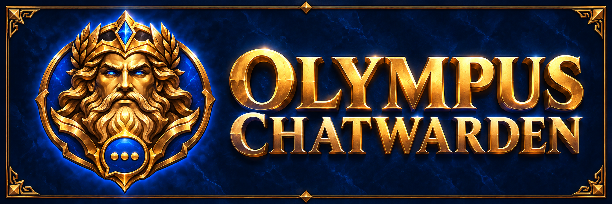

# Olympus ChatWarden 1.0

Built for Olympus and World of Warcraft: Forever. ChatWarden combines contextual personal chat filtering, contact/spam protection, mention alerts and persistent review in an Olympus-themed workspace.

**[Download 1.0.0](https://github.com/RegretnWoW/OlympusChatWarden/releases/tag/v1.0.0)** · **[Optional signed packs](rule-packs/README.md)** · **[Filtering guide](ChatWarden-1.0-Filtering-Guide.md)** · **[Release notes](OlympusChatWarden-v1.0.0-ReleaseNotes.md)**

## Features

- Mild, Balanced and Broad action presets with always-active context handling.
- Warnings, bronze redaction covers, wording replacements and hidden-message review.
- Included Olympus Protection and King Protection; optional author-signed packs with their own directions, coverage and sensitivity.
- Local Shield protection for repeated contact, repeated messages, rapid chat and selected advertising.
- Mention alerts for your full character name, nicknames and watch phrases across supported channels.
- Messages, Mentions and Shield feeds with per-character persistent activity and read states.
- Optional local Chat Capture and bookmarks.
- Personal rules, exceptions, filtering explanations and manually saved/exported feedback.
- Olympus launcher integration and Ctrl + left-click reveal for supported covered text.

## Filtering and defaults

Balanced follows the author's personal display preferences: mild unwanted opinions warn, stronger eligible expressions redact and recognized explicit threats hide. A topic reference alone is not enough for a contextual action. Neutral discussion, questions and quoted/reported wording are interpreted separately from direct assertions. The engine is bounded and deterministic; unfamiliar wording and sarcasm can still produce mistakes.

Olympus/King/USA protection permits praise and filters recognized criticism or attacks. Optional terminology packs take the selected author viewpoint: eligible support/promotion can filter while criticism stays visible. Read each pack's description before enabling it. These are personal viewing preferences, not objective judgments about other players.

Filtering, Shield, Mentions and Spam protection start on. Balanced is the default. **Gommage and Chat Capture start off.** Gommage is a separate literal meme toggle; its curated masks may cover terms even in criticism or questions. Topic preferences, masks and replacements do not automatically shield players.

Hidden-message alerts start on; redaction alerts start off. Each has its own switch. Existing explicit settings and saved data are retained when updating, except that the retired context opt-out no longer disables context handling.

## Install

1. Fully exit WoW.
2. Extract **OlympusChatWarden-v1.0.0.zip** from the release into `Interface/AddOns` so `OlympusChatWarden/OlympusChatWarden.toc` is directly inside the addon folder. Use the addon asset, not GitHub's automatic Source code ZIP.
3. Keep `WTF/SavedVariables` when updating.
4. Open through the Olympus launcher or `/ocw`. Overview is the default page.

**Current access requirement:** your character's guild name must contain Olympus as a separate word. This is a local check, not official membership verification. Features pause outside a qualifying guild and saved data is retained.

## Optional packs

Download **OlympusChatWarden-RulePacks-v1.0.0.zip**, or an individual `.ocwpack.txt` release asset. Copy the entire signed string and use **Packs > Import signed pack > Verify pack > Install pack**. Optional categories must be enabled after installation. Updates preserve category enablement and presets.

The addon ZIP does not replace saved imports. **USA Protection v5** contains the latest mild-criticism adjustment. The other current versions are Gender, Parenting, Inclusive Language, Workplace, Political Slogans and Social Terminology v9, and Body-label replacements v7. See the [pack table](rule-packs/README.md).

## Privacy and feedback

Filtering runs locally. Reports are not sent automatically; review exported text before sharing. Capture starts off. Save a filtering report with the original wording and expected action when reporting a false positive or a miss.

This release's automated checks cover filtering contrasts, signed updates, defaults, notifications, masked icon refresh, multilingual names and saved activity. Native rendering and gameplay should still be checked in the client. Future intelligence/Relay features and the Olympus Warden rebrand are not part of 1.0.

Copyright (c) 2026 Regretn. See [LICENSE.txt](OlympusChatWarden/LICENSE.txt) for usage and distribution terms.
